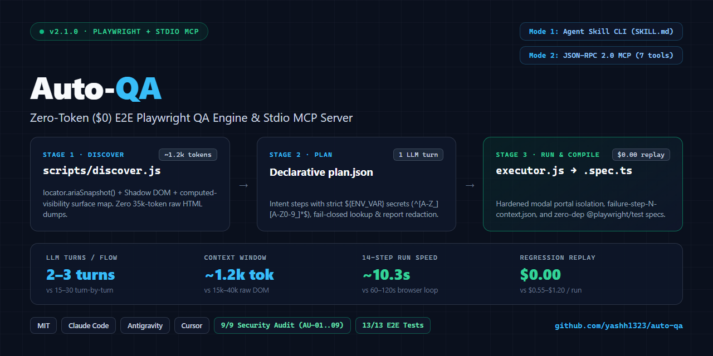
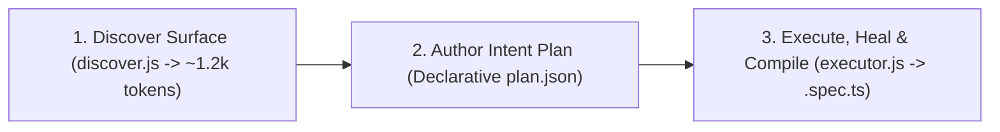

# Auto-QA: Zero-Token Playwright QA Engine & MCP Server for AI Agents

[](./LICENSE)
[](https://nodejs.org/)
[](https://playwright.dev/)
[](https://modelcontextprotocol.io/)
[](./tests/security_audit_runner.mjs)
[](#why-turn-by-turn-browser-agents-break-in-production)

<p align="center">
  
</p>

If you have ever asked **Claude Code**, **Google Antigravity**, or **Cursor** to run end-to-end QA on your web app, you already know the two ways it goes wrong:

1. **The "Blind Selector Guess" Loop**: The agent reads your React/Next.js source files, guesses what the rendered DOM looks like, writes a `.spec.ts` file, and hits `TimeoutError: locator('button.submit-btn') not found` five times in a row because of client hydration, portals, or CSS modules.
2. **The Turn-by-Turn Browser Loop** (*Chrome DevTools MCP, Puppeteer MCP, Stagehand, Browser-Use*): The agent opens a live browser and takes a DOM snapshot or screenshot after every single click. By step 12, it has burned **35,000+ context tokens**, taken **90 seconds** of round-trip LLM latency, and forced your coding session into `/compact`—only to spend another $0.85 in tokens the next time you re-run the exact same test.

**Auto-QA** fixes this by splitting **Test Planning** (1 LLM turn) from **Test Execution** (0 LLM turns, 100% local Node.js + Playwright).

---

## Why Turn-by-Turn Browser Agents Break in Production

| Metric / Architecture | Turn-by-Turn Browser MCP (`DevTools` / `Browser-Use`) | Blind Source-to-Test Authoring | **Auto-QA** (`Skill CLI` + `Stdio MCP`) |
| :--- | :--- | :--- | :--- |
| **LLM Round-Trip Turns** | 15 – 30 turns per user flow | 4 – 8 retry turns fixing broken selectors | **2 – 3 turns total** (Discover → Plan → Run) |
| **Context Window Burn** | 15,000 – 40,000 tokens (raw DOM dumps) | 5,000 – 12,000 tokens (stack traces) | **~1,200 tokens** (sanitized W3C accessibility map) |
| **Execution Speed (14 steps)** | 60 – 120 seconds | Fails on dynamic modals / sticky navs | **~10.3 seconds** (local headless Chromium) |
| **Replay / Regression Cost** | $0.55 – $1.20 per run in API tokens | $0.00 (once manually fixed) | **$0.00 forever** (0 LLM calls during execution) |
| **`position: fixed` Modals** | Often missed by `offsetParent` filters | Fails when backdrop overlaps buttons | **Scoped modal isolation** + `getBoundingClientRect()` |
| **CI/CD Output** | Locked to live agent runtime | `.spec.ts` (brittle selectors) | Compiles to native **`@playwright/test` `.spec.ts`** |

---

## How Auto-QA Works (The 3 Atomic Stages)



### Stage 1: Black-Box Surface Discovery (`scripts/discover.js`)
Instead of dumping raw HTML, Auto-QA launches headless Chromium, waits for hydration, and extracts interactive elements (`button`, `input`, `textarea`, `select`, `a[href]`) alongside modal containers (`[aria-modal="true"]`, `[role="dialog"]`, `[role="alertdialog"]`, `dialog[open]`, `.modal`) and Playwright's accessibility snapshot (`locator.ariaSnapshot()`, capped at 16,384 chars).
* Discovery and execution use native `checkVisibility()` where available. They check rendered child boxes for `display: contents`, include fixed controls, skip content Chromium has deferred off screen, and follow open shadow hosts for hidden, inert, and ARIA-hidden ancestors.
* **Output**: `cli.js discover` prints summary counts by default or writes the JSON surface map (`elements.buttons`, `elements.inputs`, `elements.links`, `elements.modals`, and `accessibilityTree`) when `-o <file>` is passed, while `auto_qa_generate_code_summary` in MCP mode writes a compact `auto_qa_tests/tmp/code_summary.yaml` (`buttons`, `inputs`, and `links`).

### Stage 2: Declarative Intent Plan (`plan.json`)
Your coding agent reads the ~1,200-token discovery map and authors a declarative JSON test plan conforming to [`references/plan-schema.json`](./references/plan-schema.json)—either by writing `auto_qa_tests/auto_qa_frontend_test_plan.json` directly in Skill CLI mode, or by calling `auto_qa_generate_frontend_test_plan` in MCP mode:

```json
{
  "projectId": "sprintdesk-e2e",
  "type": "frontend",
  "name": "SprintDesk Login & Task Creation Flow",
  "targetUrl": "http://localhost:3000",
  "priority": "p0",
  "planSteps": [
    { "type": "assertion", "description": "Assert that \"SprintDesk\" is visible" },
    { "type": "action", "description": "Click \"Sign In\"" },
    { "type": "action", "description": "Type \"${QA_EMAIL}\" into \"Email\"" },
    { "type": "action", "description": "Type \"${QA_PASSWORD}\" into \"Password\"" },
    { "type": "action", "description": "Click \"Sign In\"" },
    { "type": "assertion", "description": "Assert that \"Workspace Overview\" is visible" },
    { "type": "action", "description": "Type \"Verify zero-token replay\" into \"What needs testing?\"" },
    { "type": "action", "description": "Click \"Add Task\"" },
    { "type": "assertion", "description": "Assert that \"Verify zero-token replay\" is visible" }
  ]
}
```

### Stage 3: Self-Healing Execution (`scripts/executor.js`) & Native Compiler (`scripts/compiler.js`)
Both `executor.js` and `compiler.js` share `scripts/intent-parser.js` so runtime execution and generated code never drift. When executing a step like `Type "${QA_EMAIL}" into "Email"`, `executor.js` resolves the target locally without calling an LLM:
1. **Direct Selector Passthrough**: Immediately resolves explicit `#id`, `.class`, or `[attr]` selectors (filtered to visible nodes) if provided.
2. **Hardened Active Modal Isolation**: Traverses light and open Shadow DOM across `[aria-modal="true"]`, `[role="dialog"]`, `[role="alertdialog"]`, `dialog[open]`, and `.modal`, verifying real computed visibility (`display !== 'none'`, `visibility !== 'hidden'`, non-zero rect, ancestor visibility, and no `[hidden]`/`[inert]`/`aria-hidden="true"`, without failing on Tailwind utility tokens like `.hidden`), picking the top-most visible dialog by full CSS stacking-context (`z-index`, `fixed`/`sticky`, `transform`, `opacity < 1`, `isolation`, `filter`) / DOM order, ignoring nested `.modal` wrappers inside semantic dialogs, tagging the winner with `data-auto-qa-active-modal="true"`, and keeping blocking-modal isolation enforced on `assert-visible` fallbacks.
3. **Action-Specific Semantic Chains**:
   * **For `fill` / `type`**: `<label>` (`getByLabel`) → `placeholder` (`getByPlaceholder`) → ARIA `textbox` role (`getByRole`) → attribute substring (`input[name*="..." i], textarea[name*="..." i]`, `id*="..."`, `type="..."`).
   * **For `click`, `select`, and `check`**: Resolves via ARIA `button` / `link` / `combobox` / `checkbox` roles, `aria-label`, and exact-then-fuzzy text matching, filtered via `:visible` semantics so inert DOM duplicates never win.
   * After exact and substring locators miss, the executor also matches labels with changed trailing counts, such as `Cart (1)` and `Cart (2)`. This fallback stays inside a blocking dialog and requires a label with a letter and at least two characters.
4. **Strict `${ENV_VAR}` Secret Placeholders**: Both `executor.js` (runtime) and `compiler.js` (generated `.spec.ts` via `requireEnv("VAR", process.env["VAR"])`) accept `${ENV_VAR}` matching `^[A-Z_][A-Z0-9_]*$`, enforce `AUTO_QA_ALLOWED_ENV_PREFIXES` (MCP defaults to `QA_,AUTO_QA_,TEST_` unless `*`; optional in CLI), fail closed when unset, reject arbitrary JS expressions, and scrub raw, URL-encoded (`encodeURIComponent`/`encodeURI`), `URLSearchParams` (`+`), and lowercase percent-hex resolved values (`>= 3` chars; values `< 3` chars are skipped to avoid false-positive corruption) BEFORE truncation across stdout, pre-loop errors, `failure-step-N-context.json`, `auto-qa-test-report.md`, and `test-report-*.json`.
5. **Failure-Time Scoped Context Snapshots**: Inside the step `catch` block—before tearing down the browser—`executor.js` writes `failure-step-N-context.json` alongside `failure-step-N.png` containing the current URL/title, error, `scopedToModal`, capped visible interactive elements (`50` buttons, `50` inputs, `30` links, including Shadow DOM labels/controls) scoped to the active visible modal if open, and the live accessibility snapshot (`locator.ariaSnapshot()`, capped at 16,384 chars), with text redacted before length caps are applied. Snapshots record `capturedAt` and the application’s Git HEAD when available.

Before patching from an older snapshot, run the following command from the project root. Use `--project <dir>` to select another application root for capture or checking. The check prints JSON and warns on stderr if project files are newer or Git HEAD changed. A stale snapshot still returns exit code 0. The scan skips dependencies, Git metadata, build and QA output directories, and generated report and screenshot filenames.

```bash
node scripts/cli.js check-context-freshness auto_qa_tests/artifacts/failure-step-1-context.json
```
6. **Native Playwright `.spec.ts` Export**: Once the flow passes, `compiler.js` compiles `plan.json` into a standalone `@playwright/test` TypeScript file using chained `.or()` locators (with `.locator('visible=true')` assertion parity), parameterized `requireEnv("VAR", process.env["VAR"])` calls, `assertSafeHttpUrl()` navigation guards (including static relative URLs), accurate `assert-url` assertions, and nested `test.step()` blocks.
   * **Running compiled `.spec.ts` files**: Ensure `@playwright/test` (and `@types/node` for `process.env` in strict TypeScript) is installed in your target project, and export referenced `${ENV_VAR}` variables before running (Bash: `export QA_EMAIL="qa@example.com"`; PowerShell: `$env:QA_EMAIL="qa@example.com"`). Set `AUTO_QA_ALLOW_PRIVATE_NETWORK=1` if targeting internal RFC1918/ULA intranet hosts.

---

## Quick Start (60 Seconds)

```bash
git clone https://github.com/yashh1323/auto-qa.git
cd auto-qa
npm install
npx playwright install chromium

# Verify runtime, Chromium binary, MCP server, and compiler health
npm run doctor

# Run the security audit (AU-01–AU-09) + 17 v2.1.0 feature tests
npm test
```

---

## Dual-Mode Integration: Agent Skill CLI + Stdio MCP Server

Auto-QA runs in **two modes**. When you prompt your agent (e.g., *"Use Auto-QA to test the login and checkout flow on http://localhost:3000 and export a Playwright spec"*), [`SKILL.md`](./SKILL.md) instructs the agent to check its declared tools: if `auto_qa_*` MCP tools are registered, it uses **MCP Mode**; otherwise, it falls back to **Skill CLI Mode** via terminal commands.

### Option 1: Standalone Agent Skill / CLI Mode (Zero Config)
Install as an agent skill in **Google Antigravity / Gemini CLI** by cloning into your skills folder and installing dependencies (the agent automatically reads `SKILL.md` to invoke `scripts/cli.js`):

```bash
git clone https://github.com/yashh1323/auto-qa.git ~/.gemini/config/skills/auto-qa
cd ~/.gemini/config/skills/auto-qa && npm install && npx playwright install chromium
```
*(For **Claude Code** or **Cursor**, either install the full cloned `auto-qa` directory with `npm install && npx playwright install chromium` where your skill path points—not `SKILL.md` alone, since it invokes `scripts/cli.js`—or use **Option 2: MCP Server Mode** below).*

Or run any subcommand (`discover`, `run`, `compile`, `bootstrap`, `doctor`, `mcp`) directly from your terminal:

```bash
# 1. Compile an example plan into native @playwright/test TypeScript (.spec.ts) — works offline immediately
node scripts/cli.js compile examples/client-login-checkout.json -o tests/e2e/checkout.spec.ts

# 2. Crawl any live URL (or your local dev server) into a compact JSON surface map
node scripts/cli.js discover https://example.com -o auto_qa_tests/tmp/surface.json

# 3. Execute an intent test plan against a running target URL (add --no-headless to watch live)
node scripts/cli.js run examples/client-login-checkout.json -u http://localhost:3000
```

### Option 2: Model Context Protocol (MCP) Server Mode
Auto-QA includes a dependency-free JSON-RPC 2.0 `stdio` MCP server (`scripts/mcp-server.js`) exposing 8 structured tools.

#### Claude Code
```bash
claude mcp add auto-qa node "/absolute/path/to/auto-qa/scripts/mcp-server.js"
```

#### Cursor / Windsurf / Antigravity (`mcp.json`)
```json
{
  "mcpServers": {
    "auto-qa": {
      "command": "node",
      "args": ["/absolute/path/to/auto-qa/scripts/mcp-server.js"]
    }
  }
}
```

#### Exposed MCP Tools
| Tool Name | Purpose |
| :--- | :--- |
| `auto_qa_bootstrap` | Initializes `auto_qa_tests/tmp/config.json` with target project root and base URL. |
| `auto_qa_generate_code_summary` | Crawls live URL and writes sanitized interactive `buttons`, `inputs`, and `links` to `auto_qa_tests/tmp/code_summary.yaml`. |
| `auto_qa_generate_standardized_prd` | Generates a TestSprite-schema-compatible PRD scaffold (`standard_prd.json`). |
| `auto_qa_generate_frontend_test_plan` | Saves declarative frontend test steps (`auto_qa_frontend_test_plan.json`). |
| `auto_qa_generate_backend_test_plan` | Saves a TestSprite-schema-compatible backend endpoint assertion manifest (`auto_qa_backend_test_plan.json`). |
| `auto_qa_execute_and_heal` | Executes frontend `planSteps` in headless Chromium, captures `failure-step-N.png` + `failure-step-N-context.json`, and writes `auto-qa-test-report.md`. |
| `auto_qa_check_context_freshness` | Checks a failure snapshot against the application using `projectPath` and `contextFilePath`. Returns a non-blocking warning when stale. |
| `auto_qa_compile_to_playwright` | Compiles `planPath` into native `@playwright/test` TypeScript (`outputPath`) confined to `projectPath` (`AUTO_QA_WORKSPACE_ROOT`). |

*Note: All MCP artifacts (`auto_qa_tests/tmp/code_summary.yaml`, `auto_qa_tests/tmp/config.json`, `standard_prd.json`, `auto_qa_frontend_test_plan.json`, `auto_qa_backend_test_plan.json`, `auto_qa_tests/artifacts/failure-step-N.png` + `failure-step-N-context.json`, and `auto-qa-test-report.md`) are written inside `<projectPath>/auto_qa_tests/`.*

---

## Supported Intent Grammar

Intent matching in `executor.js` and `compiler.js` is **case-insensitive** and accepts either single quotes (`'...'`) or escaped double quotes (`\"...\"`) around target labels and values:

| Intent Type | Plain-English Syntax Examples |
| :--- | :--- |
| **Navigation** | `navigate to https://example.com/login` · `go to /dashboard` |
| **Text Input (`<input>` & `<textarea>`)** | `type "alex@example.com" into "Work Email"` · `fill "${QA_EMAIL}" into "Email"` · `fill "Sprint Goal" into "Description"` |
| **Clicks & Triggers** | `click "Sign In"` · `press button "Create Project"` |
| **Dropdowns (`<select>`)** | `select "Enterprise Plan" from "Plan Type"` |
| **Checkboxes** | `check "Remember me"` · `tick checkbox "Accept Terms"` |
| **Positive Visibility Assertions** | `verify "Dashboard" is visible` · `assert that "Added to cart" appears` |
| **Negative Visibility Assertions** | `verify "Loading..." is not visible` · `assert that "Error modal" disappears` |
| **Text Substring Assertions** | `verify text "Order Confirmed"` · `assert page contains "1 Item"` |
| **URL Assertions** | `verify URL contains "/checkout"` |

---

## Security & Hardening Architecture

Because QA automation tools bridge untrusted web DOMs, LLM inputs, and the local filesystem, Auto-QA enforces nine security controls verified by `AU-01` – `AU-09` in [`tests/security_audit_runner.mjs`](./tests/security_audit_runner.mjs):

1. **Parameterized Code Generation (`AU-01`)**: `compiler.js` serializes all user strings via `JSON.stringify()` and constructs regexes via `new RegExp(...)` with escaped forward slashes and metacharacters, preventing template or code injection in generated `.spec.ts` files.
2. **MCP Workspace Path Confinement (`AU-02`)**: `assertInsideDirectory()` in `mcp-server.js` performs lexical `..` checks plus a component-by-component `lstatSync()` / `realpathSync()` walk enforcing `AUTO_QA_WORKSPACE_ROOT` confinement on MCP plan reads and `.spec.ts` compilation output paths, blocking relative (`../../`), absolute (`/etc/passwd`, `C:\Windows\...`), cross-drive, live symlink/junction, and dangling symlink/junction escapes.
3. **Protocol Scheme Allowlisting, CIDR/DNS Validation & Redirect SSRF Guard (`AU-03`)**: `assertValidHttpUrl()` and `assertSafeResolvedUrl()` in `url-utils.js` restrict navigation to `http:` and `https:` (blocking `file:///`, `javascript:`, `data:`, UNC `\\`, protocol-relative `//`, backslash/control-character relative paths, cloud IMDS ranges `169.254.0.0/16`, `100.100.100.200`, `168.63.129.16`, `192.0.0.192`, `fe80::/10`, `fd00:ec2::/32`, embedded IPv6 forms, DNS-resolved metadata/private rebinds, and RFC1918/CGNAT/ULA private networks unless `AUTO_QA_ALLOW_PRIVATE_NETWORK=1` is set), while `attachSsrfRouteGuard()` pairs `context.route`, `context.routeWebSocket`, and CDP `Fetch.enable` to block unsafe multi-hop HTTP 3xx redirects and `ws://` connections while keeping initial `localhost`/`127.0.0.1`/`[::1]` allowed.
4. **YAML 1.2 & Markdown Link/Cell Sanitization (`AU-04`)**: `formatCodeSummaryYaml()` emits valid double-quoted YAML 1.2 key-value mappings (`code_summary.yaml`) with full newline and C1 control-character (`\x7f-\x9f`, `\u2028-\u2029`) escaping, while `sanitizeMdCell()` and `toRelativeArtifactLink()` neutralize Markdown/link injection in reports.
5. **CSS Attribute & Regex Escaping (`AU-05`)**: Double quotes, backslashes, newlines, and regex metacharacters in target names are sanitized via `escapeCssString()` and `escapeRegex()` before building selectors.
6. **Repository Hygiene & Resource Cleanup (`AU-06`)**: `AU-06` scans shipped repository files to assert zero hardcoded personal local home paths or credentials exist; at runtime, `executor.js` and `discover.js` auto-dismiss synchronous `alert()`/`confirm()`/`beforeunload` dialogs, block background Service Workers (`serviceWorkers: 'block'`), guard `chromium.launch()` shutdown epochs, drain in-flight MCP RPCs on `stdin` EOF, and guarantee `browser.close()` via `try / finally` (`closeAllBrowsers()` / `closeAllDiscoverBrowsers()`).
7. **Strict `${ENV_VAR}` Secret & Prefix Policy (`AU-07`)**: `env-utils.js` restricts placeholders strictly to `^[A-Z_][A-Z0-9_]*$`, rejects arbitrary expressions, enforces `AUTO_QA_ALLOWED_ENV_PREFIXES` in MCP (`QA_,AUTO_QA_,TEST_` by default, `*` to widen) and CLI/compiler, emits fail-closed `requireEnv("VAR", process.env["VAR"])` calls in compiled specs, and redacts resolved secrets (`>= 3` chars) from stdout, stderr logs, and `test-report-*.json`.
8. **Pre-Redaction Truncation Order & Encoded Leak Scrubbing (`AU-08`)**: `redactSecrets()` scrubs raw, `encodeURIComponent`, `encodeURI`, `URLSearchParams` (`+`), and lowercase percent-hex secret variants (`>= 3` chars; values `< 3` chars are skipped to avoid false-positive text corruption) BEFORE truncation limits across pre-loop errors, `report.testName`, `step.description`/`error`, `failure-step-N-context.json`, `auto-qa-test-report.md`, and `test-report-*.json`.
9. **Linear Intent Parsing & Bounded Loop Guards (`AU-09`)**: `intent-parser.js` uses a linear-time $O(N)$ quoted-literal scanner, isolates classification keywords outside quoted literals, recognizes negative contractions (`isn't`, `doesn't`), throws on unsupported verbs instead of silently passing, enforces `maxSteps` (`200` in both executor & compiler) and `runTimeoutMs` (`300000` ms), and caps `report.consoleErrors` at `100` entries (`1000` chars each, tracking `consoleErrorsTruncated`).

---

## When NOT to Use Auto-QA

* **WebGL / HTML5 `<canvas>` Applications**: If your UI renders entirely inside a single `<canvas>` element (e.g., Three.js games, Figma-like vector editors) without DOM nodes or W3C accessibility labels, semantic locators cannot see inside the canvas. Use a coordinate-based vision model instead.
* **Unstructured Chaos Fuzzing**: If you have no target user story and want an agent to randomly click around an unfamiliar site to see what breaks, an interactive turn-by-turn browser loop is a better fit than a declarative plan runner.

---

## Repository Layout

```text
auto-qa/
├── scripts/
│   ├── cli.js                # Unified CLI (mcp, discover, run, check-context-freshness, compile, bootstrap, doctor)
│   ├── mcp-server.js         # Zero-dependency JSON-RPC 2.0 stdio MCP server (8 tools)
│   ├── discover.js           # Headless Chromium light/Shadow DOM + ariaSnapshot() surface crawler
│   ├── browser-dom.js        # Shared Chromium checkVisibility(), display: contents & shadow DOM helpers
│   ├── context-freshness.js  # Failure-context capturedAt & Git HEAD staleness checker
│   ├── env-utils.js          # Strict ${ENV_VAR} tokenizer, prefix policy, requireEnv() & redactor
│   ├── intent-parser.js      # Shared single-source intent IR for executor & compiler
│   ├── url-utils.js          # URL/DNS/CIDR validator, CDP/WS SSRF guard & MD escaping
│   ├── write-output.js       # Atomic link-safe writer for reports, snapshots & compiled specs
│   ├── executor.js           # Self-healing intent runner, modal portal hardening & failure snapshots
│   └── compiler.js           # Declarative plan.json -> native @playwright/test .spec.ts compiler
├── tests/
│   ├── security_audit_runner.mjs  # 9-unit automated security & hygiene test suite (AU-01–AU-09)
│   └── v2_1_features.test.mjs     # 17-test Playwright/CLI/MCP suite for v2.1.0 features
├── examples/
│   ├── client-lead-gen.json       # Sample B2B lead funnel test plan
│   ├── client-login-checkout.json # Sample e-commerce cart & checkout test plan
│   └── env-var-login.json         # Sample ${QA_EMAIL} / ${QA_PASSWORD} secret-placeholder plan
├── references/
│   ├── blackbox-testing-guide.md  # Pre-flight credential & 5-step black-box QA guide
│   └── plan-schema.json           # JSON Schema Draft-07 specification for test plans
├── SKILL.md                # Dual-mode operational instructions for AI coding agents
├── package.json
└── LICENSE                 # MIT
```

## License

MIT — see [LICENSE](./LICENSE).
