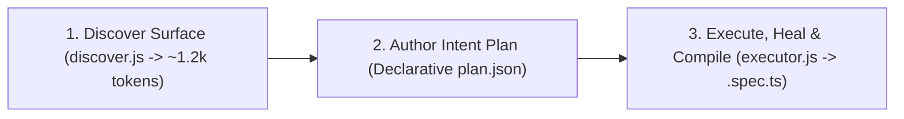

# Auto-QA: Zero-Token Playwright QA Engine & MCP Server for AI Agents

[](./LICENSE)
[](https://nodejs.org/)
[](https://playwright.dev/)
[](https://modelcontextprotocol.io/)
[](./tests/security_audit_runner.mjs)
[](#why-turn-by-turn-browser-agents-break-in-production)

<p align="center">
  
</p>

If you have ever asked **Claude Code**, **Google Antigravity**, or **Cursor** to run end-to-end QA on your web app, you already know the two ways it goes wrong:

1. **The "Blind Selector Guess" Loop**: The agent reads your React/Next.js source files, guesses what the rendered DOM looks like, writes a `.spec.ts` file, and hits `TimeoutError: locator('button.submit-btn') not found` five times in a row because of client hydration, portals, or CSS modules.
2. **The Turn-by-Turn Browser Loop** (*Chrome DevTools MCP, Puppeteer MCP, Stagehand, Browser-Use*): The agent opens a live browser and takes a DOM snapshot or screenshot after every single click. By step 12, it has burned **35,000+ context tokens**, taken **90 seconds** of round-trip LLM latency, and forced your coding session into `/compact`—only to spend another $0.85 in tokens the next time you re-run the exact same test.

**Auto-QA** fixes this by splitting **Test Planning** (1 LLM turn) from **Test Execution** (0 LLM turns, 100% local Node.js + Playwright).

---

## Why Turn-by-Turn Browser Agents Break in Production

| Metric / Architecture | Turn-by-Turn Browser MCP (`DevTools` / `Browser-Use`) | Blind Source-to-Test Authoring | **Auto-QA** (`Skill CLI` + `Stdio MCP`) |
| :--- | :--- | :--- | :--- |
| **LLM Round-Trip Turns** | 15 – 30 turns per user flow | 4 – 8 retry turns fixing broken selectors | **2 – 3 turns total** (Discover → Plan → Run) |
| **Context Window Burn** | 15,000 – 40,000 tokens (raw DOM dumps) | 5,000 – 12,000 tokens (stack traces) | **~1,200 tokens** (sanitized W3C accessibility map) |
| **Execution Speed (14 steps)** | 60 – 120 seconds | Fails on dynamic modals / sticky navs | **~10.3 seconds** (local headless Chromium) |
| **Replay / Regression Cost** | $0.55 – $1.20 per run in API tokens | $0.00 (once manually fixed) | **$0.00 forever** (0 LLM calls during execution) |
| **`position: fixed` Modals** | Often missed by `offsetParent` filters | Fails when backdrop overlaps buttons | **Scoped modal isolation** + `getBoundingClientRect()` |
| **CI/CD Output** | Locked to live agent runtime | `.spec.ts` (brittle selectors) | Compiles to native **`@playwright/test` `.spec.ts`** |

---

## How Auto-QA Works (The 3 Atomic Stages)



### Stage 1: Black-Box Surface Discovery (`scripts/discover.js`)
Instead of dumping raw HTML, Auto-QA launches headless Chromium, waits for hydration, and extracts interactive elements (`button`, `input`, `textarea`, `select`, `a[href]`, `[role="dialog"]`) alongside Playwright's native W3C accessibility tree (`page.accessibility.snapshot()`).
* **Sticky Header & Modal Fix**: Standard crawlers check `el.offsetParent !== null`, which returns `null` for `position: fixed` sticky navbars and modal overlays in the CSSOM. Auto-QA computes real viewport geometry via `getBoundingClientRect()` and `window.getComputedStyle(el)`.
* **Output**: `cli.js discover` saves the full JSON surface (`elements` + `modals` + `accessibilityTree`), while `auto_qa_generate_code_summary` in MCP mode writes a compact `code_summary.yaml` (`buttons`, `inputs`, and `links`).

### Stage 2: Declarative Intent Plan (`plan.json`)
Your coding agent reads the ~1,200-token discovery map and authors a declarative JSON test plan conforming to [`references/plan-schema.json`](./references/plan-schema.json)—either by writing `auto_qa_tests/auto_qa_frontend_test_plan.json` directly in Skill CLI mode, or by calling `auto_qa_generate_frontend_test_plan` in MCP mode:

```json
{
  "projectId": "sprintdesk-e2e",
  "type": "frontend",
  "name": "SprintDesk Login & Task Creation Flow",
  "targetUrl": "http://localhost:3000",
  "priority": "p0",
  "planSteps": [
    { "type": "assertion", "description": "Assert that \"SprintDesk\" is visible" },
    { "type": "action", "description": "Click \"Sign In\"" },
    { "type": "action", "description": "Type \"qa-tester@example.com\" into \"Email\"" },
    { "type": "action", "description": "Type \"TestPass123!\" into \"Password\"" },
    { "type": "action", "description": "Click \"Sign In\"" },
    { "type": "assertion", "description": "Assert that \"Logged in: qa-tester@example.com\" is visible" },
    { "type": "action", "description": "Type \"Verify zero-token replay\" into \"What needs testing?\"" },
    { "type": "action", "description": "Click \"Add Task\"" },
    { "type": "assertion", "description": "Assert that \"Verify zero-token replay\" is visible" }
  ]
}
```

### Stage 3: Self-Healing Execution (`scripts/executor.js`) & Native Compiler (`scripts/compiler.js`)
When executing a step like `Type "qa-tester@example.com" into "Email"`, `executor.js` resolves the target locally without calling an LLM:
1. **Direct Selector Passthrough**: Immediately resolves explicit `#id`, `.class`, or `[attr]` selectors if provided.
2. **Active Modal Isolation**: Detects open `[role="dialog"]:not(.hidden)`, `.modal:not(.hidden)`, or `[aria-modal="true"]:not(.hidden)` containers and scopes element lookup inside the active modal before falling back to the page root.
3. **Action-Specific Semantic Chains**:
   * **For `fill` / `type`**: `<label>` (`getByLabel`) → `placeholder` (`getByPlaceholder`) → ARIA `textbox` role (`getByRole`) → attribute substring (`input[name*="..." i], textarea[name*="..." i]`, `id*="..."`, `type="..."`).
   * **For `click`, `select`, and `check`**: Resolves via ARIA `button` / `link` / `combobox` / `checkbox` roles, `aria-label`, and exact-then-fuzzy text matching.
4. **Native Playwright `.spec.ts` Export**: Once the flow passes, `compiler.js` compiles `plan.json` into a clean `@playwright/test` TypeScript file using chained `.or()` locators and nested `test.step()` blocks that runs in GitHub Actions with zero dependencies on Auto-QA.

---

## Quick Start (60 Seconds)

```bash
git clone https://github.com/yashh1323/auto-qa.git
cd auto-qa
npm install
npx playwright install chromium

# Verify runtime, Chromium binary, MCP server, and compiler health
npm run doctor

# Run the 6-unit security & hygiene test suite
npm test
```

---

## Dual-Mode Integration: Agent Skill CLI + Stdio MCP Server

Auto-QA runs in **two modes**. When you prompt your agent (e.g., *"Use Auto-QA to test the login and checkout flow on http://localhost:3000 and export a Playwright spec"*), [`SKILL.md`](./SKILL.md) instructs the agent to check its declared tools: if `auto_qa_*` MCP tools are registered, it uses **MCP Mode**; otherwise, it falls back to **Skill CLI Mode** via terminal commands.

### Option 1: Standalone Agent Skill / CLI Mode (Zero Config)
Install as an agent skill in **Google Antigravity / Gemini CLI** by cloning into your skills folder and installing dependencies (the agent automatically reads `SKILL.md` to invoke `scripts/cli.js`):

```bash
git clone https://github.com/yashh1323/auto-qa.git ~/.gemini/config/skills/auto-qa
cd ~/.gemini/config/skills/auto-qa && npm install && npx playwright install chromium
```
*(For **Claude Code** or **Cursor**, either copy `SKILL.md` into your project's `.claude/skills/` / `.cursor/rules/` or use **Option 2: MCP Server Mode** below).*

Or run any subcommand (`discover`, `run`, `compile`, `bootstrap`, `doctor`, `mcp`) directly from your terminal:

```bash
# 1. Compile an example plan into native @playwright/test TypeScript (.spec.ts) — works offline immediately
node scripts/cli.js compile examples/client-login-checkout.json -o tests/e2e/checkout.spec.ts

# 2. Crawl any live URL (or your local dev server) into a compact JSON surface map
node scripts/cli.js discover https://example.com -o auto_qa_tests/tmp/surface.json

# 3. Execute an intent test plan against a running target URL (add --no-headless to watch live)
node scripts/cli.js run examples/client-login-checkout.json -u http://localhost:3000
```

### Option 2: Model Context Protocol (MCP) Server Mode
Auto-QA includes a dependency-free JSON-RPC 2.0 `stdio` MCP server (`scripts/mcp-server.js`) exposing 7 structured tools.

#### Claude Code
```bash
claude mcp add auto-qa node "/absolute/path/to/auto-qa/scripts/mcp-server.js"
```

#### Cursor / Windsurf / Antigravity (`mcp.json`)
```json
{
  "mcpServers": {
    "auto-qa": {
      "command": "node",
      "args": ["/absolute/path/to/auto-qa/scripts/mcp-server.js"]
    }
  }
}
```

#### Exposed MCP Tools
| Tool Name | Purpose |
| :--- | :--- |
| `auto_qa_bootstrap` | Initializes `auto_qa_tests/tmp/config.json` with target project root and base URL. |
| `auto_qa_generate_code_summary` | Crawls live URL and writes sanitized interactive `buttons`, `inputs`, and `links` to `code_summary.yaml`. |
| `auto_qa_generate_standardized_prd` | Generates a TestSprite-schema-compatible PRD scaffold (`standard_prd.json`). |
| `auto_qa_generate_frontend_test_plan` | Saves declarative frontend test steps (`auto_qa_frontend_test_plan.json`). |
| `auto_qa_generate_backend_test_plan` | Saves a TestSprite-schema-compatible backend endpoint assertion manifest (`auto_qa_backend_test_plan.json`). |
| `auto_qa_execute_and_heal` | Executes frontend `planSteps` in headless Chromium, captures failure screenshots, and writes `auto-qa-test-report.md`. |
| `auto_qa_compile_to_playwright` | Compiles `plan.json` into native `@playwright/test` TypeScript (`.spec.ts`). |

*Note: All MCP artifacts (`code_summary.yaml`, `standard_prd.json`, `auto_qa_frontend_test_plan.json`, failure screenshots, and `auto-qa-test-report.md`) are written inside `<projectPath>/auto_qa_tests/`.*

---

## Supported Intent Grammar

Intent matching in `executor.js` and `compiler.js` is **case-insensitive** and accepts either single quotes (`'...'`) or escaped double quotes (`\"...\"`) around target labels and values:

| Intent Type | Plain-English Syntax Examples |
| :--- | :--- |
| **Navigation** | `navigate to https://example.com/login` · `go to /dashboard` |
| **Text Input (`<input>` & `<textarea>`)** | `type "alex@example.com" into "Work Email"` · `fill "Sprint Goal" into "Description"` |
| **Clicks & Triggers** | `click "Sign In"` · `press button "Create Project"` |
| **Dropdowns (`<select>`)** | `select "Enterprise Plan" from "Plan Type"` |
| **Checkboxes** | `check "Remember me"` · `tick checkbox "Accept Terms"` |
| **Positive Visibility Assertions** | `verify "Dashboard" is visible` · `assert that "Added to cart" appears` |
| **Negative Visibility Assertions** | `verify "Loading..." is not visible` · `assert that "Error modal" disappears` |
| **Text Substring Assertions** | `verify text "Order Confirmed"` · `assert page contains "1 Item"` |
| **URL Assertions** | `verify URL contains "/checkout"` |

---

## Security & Hardening Architecture

Because QA automation tools bridge untrusted web DOMs, LLM inputs, and the local filesystem, Auto-QA enforces six security controls verified by `AU-01` – `AU-06` in [`tests/security_audit_runner.mjs`](./tests/security_audit_runner.mjs):

1. **Parameterized Code Generation (`AU-01`)**: `compiler.js` serializes all user strings via `JSON.stringify()` and constructs regexes via `new RegExp(...)` with escaped forward slashes and metacharacters, preventing template or code injection in generated `.spec.ts` files.
2. **MCP Workspace Path Confinement (`AU-02`)**: `assertInsideDirectory()` in `mcp-server.js` blocks relative (`../../`), absolute (`/etc/passwd`, `C:\Windows\...`), and cross-drive path traversal on MCP plan execution and compilation output paths.
3. **Protocol Scheme Allowlisting (`AU-03`)**: `assertValidHttpUrl()` restricts browser navigation strictly to `http:` and `https:`, blocking `file:///`, `javascript:`, `data:`, and Windows UNC (`\\`) SMB paths.
4. **YAML & Prompt Injection Sanitization (`AU-04`)**: Scraped DOM labels are JSON-encoded and length-capped (150 chars) before writing `code_summary.yaml`.
5. **CSS Attribute & Regex Escaping (`AU-05`)**: Double quotes, backslashes, and newlines in target names are sanitized via `escapeCssString()` and `escapeRegex()` before building selectors.
6. **PII Hygiene & Process Cleanup (`AU-06`)**: `executor.js` and `discover.js` auto-dismiss synchronous `alert()`/`confirm()`/`beforeunload` dialogs, block background Service Workers (`serviceWorkers: 'block'`), and guarantee `browser.close()` inside top-level `try / finally` blocks.

---

## When NOT to Use Auto-QA

* **WebGL / HTML5 `<canvas>` Applications**: If your UI renders entirely inside a single `<canvas>` element (e.g., Three.js games, Figma-like vector editors) without DOM nodes or W3C accessibility labels, semantic locators cannot see inside the canvas. Use a coordinate-based vision model instead.
* **Unstructured Chaos Fuzzing**: If you have no target user story and want an agent to randomly click around an unfamiliar site to see what breaks, an interactive turn-by-turn browser loop is a better fit than a declarative plan runner.

---

## Repository Layout

```text
auto-qa/
├── scripts/
│   ├── cli.js              # Unified CLI (mcp, discover, run, compile, bootstrap, doctor)
│   ├── mcp-server.js       # Zero-dependency JSON-RPC 2.0 stdio MCP server (7 tools)
│   ├── discover.js         # Headless Chromium DOM + W3C accessibility surface crawler
│   ├── executor.js         # Self-healing intent runner + active modal isolation
│   └── compiler.js         # Declarative plan.json -> native @playwright/test .spec.ts compiler
├── tests/
│   └── security_audit_runner.mjs  # 6-unit automated security & PII hygiene test suite
├── examples/
│   ├── client-lead-gen.json       # Sample B2B lead funnel test plan
│   └── client-login-checkout.json # Sample e-commerce cart & checkout test plan
├── references/
│   ├── blackbox-testing-guide.md  # Pre-flight credential & 4-step black-box QA guide
│   └── plan-schema.json           # JSON Schema Draft-07 specification for test plans
├── SKILL.md                # Dual-mode operational instructions for AI coding agents
├── package.json
└── LICENSE                 # MIT
```

## License

MIT — see [LICENSE](./LICENSE).
