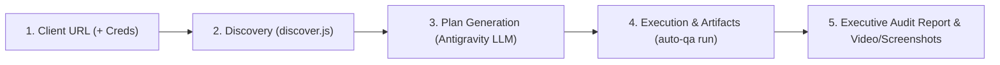

# Black-Box Client Website QA Testing Guide

When performing QA on a client's website, **you do NOT need access to their Git repository, React source code, or backend codebase**.

---

## 1. The Pre-Flight Credential Gathering Protocol

Whenever a workflow requires authentication (e.g. user dashboards, member portals, checkout accounts, admin views):

### When & How to Ask the Client
Do not guess or try brute-forcing credentials. Proactively prompt the user/client:
> *"To verify the authenticated user workflow on `<Target URL>`, I need a dedicated QA/test account. Could you please provide:*
> 1. *Test Email or Username*
> 2. *Test Password*
> *(Or should I test the public guest pages and invalid-login rejection paths first?)"*

### Credential Safety Invariants
1. **Never ask for or accept production super-admin secrets**. Always request disposable test/staging credentials.
2. **Inject into actions**:
   ```json
   { "type": "action", "description": "Type \"testuser@clientcorp.com\" into \"Email\"" },
   { "type": "action", "description": "Type \"TestPassword123!\" into \"Password\"" },
   { "type": "action", "description": "Click \"Sign In\"" }
   ```
3. **Redaction**: In final client-facing reports and video/screenshot summaries, passwords and sensitive tokens must be redacted or masked.

---

## 2. The 4-Step Black-Box QA Workflow



### Step 1: Gather Client Inputs
You only need:
1. **Target URL**: (e.g. `https://clientapp.com` or staging link)
2. **User Journey**: What workflow needs verification? (e.g. *"Lead contact form submission"*, *"E-commerce checkout"*, *"User sign-in & password reset"*).
3. **Credentials** (if gated): Test account username and password.

### Step 2: Automated Surface Discovery
Run the discovery crawler against the live client URL:
```bash
node scripts/cli.js discover "https://clientapp.com" --output ./discovery.json
```
The crawler inspects the live page using headless Chromium and extracts:
- All buttons, submit inputs, and clickable controls
- Input fields, placeholders, labels, and validation flags
- Active modals, dialogs, and navigation routes

### Step 3: Author the Declarative Test Plan
Because the runner uses **semantic accessibility roles** instead of CSS selectors, tests are written in plain English:
```json
{
  "name": "Client Lead Generation Form Submission",
  "targetUrl": "https://clientapp.com/contact",
  "planSteps": [
    { "type": "action", "description": "Type \"Alex Rivera\" into \"Full Name\"" },
    { "type": "action", "description": "Type \"alex@testcorp.com\" into \"Work Email\"" },
    { "type": "action", "description": "Select \"Enterprise Plan\" from \"Plan Type\"" },
    { "type": "action", "description": "Click \"Request Demo\"" },
    { "type": "assertion", "description": "Assert that \"Thank you! Our sales team will contact you\" is visible" }
  ]
}
```

### Step 4: Execute & Deliver Audit Report
Run the test:
```bash
node scripts/cli.js run contact-test.json
```
Deliver to the client:
- Executive summary report (pass/fail status with millisecond step timing)
- Visual screenshots proving success or highlighting defect locations
- Browser console error dump
