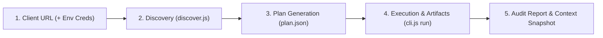

# Black-Box Client Website QA Testing Guide

When performing QA on a client's website, **you do NOT need access to their Git repository, React source code, or backend codebase**.

---

## 1. The Pre-Flight Credential Gathering Protocol

Whenever a workflow requires authentication (e.g. user dashboards, member portals, checkout accounts, admin views):

### When & How to Ask the Client
Do not guess or try brute-forcing credentials. Proactively prompt the user/client:
> *"To verify the authenticated user workflow on `<Target URL>`, I need a dedicated QA/test account. Could you export:*
> 1. *`QA_EMAIL` (Test Email or Username)*
> 2. *`QA_PASSWORD` (Test Password)*
> *(Or should I test the public guest pages and invalid-login rejection paths first?)"*

### Credential Safety Invariants
1. **Never ask for or accept production super-admin secrets**. Always use disposable test/staging credentials.
2. **Use strict `${ENV_VAR}` placeholders instead of hardcoded secrets**:
   ```json
   { "type": "action", "description": "Type \"${QA_EMAIL}\" into \"Email\"" },
   { "type": "action", "description": "Type \"${QA_PASSWORD}\" into \"Password\"" },
   { "type": "action", "description": "Click \"Sign In\"" }
   ```
   Export variables in your shell before running (`export QA_EMAIL=...` in bash/zsh, or `$env:QA_EMAIL="..."` in PowerShell). Auto-QA validates strict identifiers (`^[A-Z_][A-Z0-9_]*$`), fails closed if unset, and redacts resolved values from stdout and JSON/Markdown reports.
3. **Redaction**: Never commit real credentials into `plan.json` or generated `.spec.ts` files.

---

## 2. The 5-Step Black-Box QA Workflow



### Step 1: Gather Client Inputs
You only need:
1. **Target URL**: (e.g. `https://clientapp.com` or staging link)
2. **User Journey**: What workflow needs verification? (e.g. *"Lead contact form submission"*, *"E-commerce checkout"*, *"User sign-in & dashboard verify"*).
3. **Credentials** (if gated): Environment variables (`QA_EMAIL`, `QA_PASSWORD`).

### Step 2: Automated Surface Discovery
Run the discovery crawler against the live client URL:
```bash
node scripts/cli.js discover "https://clientapp.com" -o ./discovery.json
```
The crawler inspects the live page using headless Chromium and extracts:
- All visible buttons, submit inputs, and clickable controls
- Input fields, placeholders, labels, and validation flags
- Active modals, dialogs, navigation routes, and accessibility snapshot (`ariaSnapshot()`)

### Step 3: Author the Declarative Test Plan
Because the runner uses **semantic accessibility roles** instead of CSS selectors, tests are written in plain English:
```json
{
  "name": "Client Lead Generation Form Submission",
  "targetUrl": "https://clientapp.com/contact",
  "planSteps": [
    { "type": "action", "description": "Type \"Alex Rivera\" into \"Full Name\"" },
    { "type": "action", "description": "Type \"alex@testcorp.com\" into \"Work Email\"" },
    { "type": "action", "description": "Select \"Enterprise Plan\" from \"Plan Type\"" },
    { "type": "action", "description": "Click \"Request Demo\"" },
    { "type": "assertion", "description": "Assert that \"Thank you! Our sales team will contact you\" is visible" }
  ]
}
```

### Step 4: Execute & Deliver Audit Report
Run the test:
```bash
node scripts/cli.js run contact-test.json
```
Deliver to the client:
- Executive summary report (`auto-qa-test-report.md` and `test-report-*.json` with millisecond step timing and console errors)
- Visual screenshots (`failure-step-N.png` and `run-final-*.png`) highlighting state or defect locations
- Scoped failure context snapshots (`failure-step-N-context.json`, capturing capped interactive elements inside any active modal or page + accessibility snapshot)
